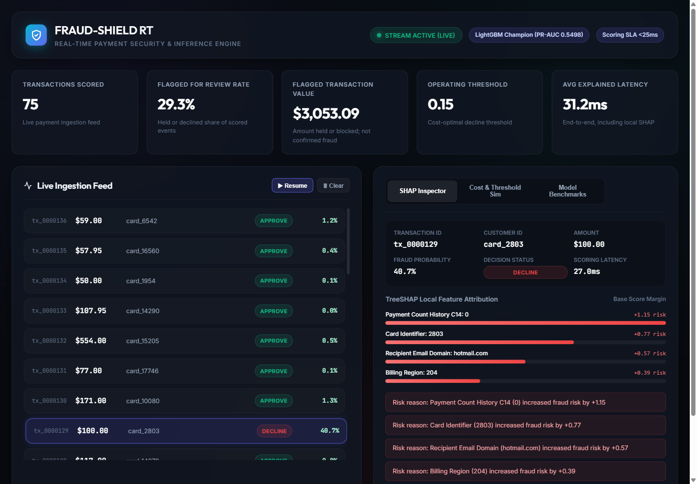
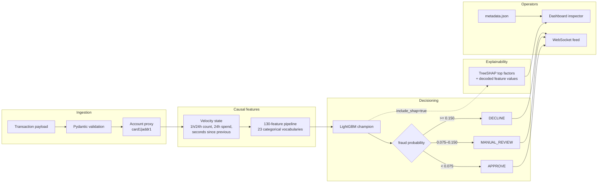

# FRAUD-SHIELD RT: Real-Time Transaction Fraud Detection

[](https://python.org)
[](https://fastapi.tiangolo.com)
[](https://lightgbm.readthedocs.io/)
[](https://www.docker.com/)
[](https://pytest.org)
[](.github/workflows/ci.yml)

A production-shaped fraud scoring service trained on the **IEEE-CIS Fraud Detection**
dataset. It covers the path from raw transactions to a decision an operator can act
on: time-based validation, account-level velocity features, a LightGBM champion,
cost-based decision thresholds, local TreeSHAP explanations, an API with auth and
rate limits, and a live operator dashboard.

This is a reference implementation and portfolio project, not a certified
financial-compliance system. The [limitations](#limitations) section is part of
the design, not fine print.



*Dashboard replaying held-out IEEE-CIS rows: live decisions, a SHAP inspector, the
PR curve and an offline cost simulator. The feed has no fraud label, so the KPIs
describe flagged share and flagged value, not confirmed fraud.*

---

## Results

Evaluated on the **last 20% of transactions by `TransactionDT`** — 118,108 rows the
models never saw, with a 3.441% fraud rate. The split is chronological, not random,
so adjacent transactions and future behaviour cannot leak into training.

| Model | PR-AUC | ROC-AUC | Recall @ top 1% volume | Precision @ top 1% volume |
| :--- | :---: | :---: | :---: | :---: |
| **LightGBM (champion)** | **0.5498** | **0.9030** | **0.2569** | **0.8832** |
| XGBoost | 0.4854 | 0.9016 | 0.2475 | 0.8511 |
| Isolation Forest (baseline) | 0.0903 | 0.7223 | 0.0030 | 0.0102 |

- PR-AUC is the selection metric. A 3.4% positive rate makes ROC-AUC and accuracy
  look flattering; the champion is chosen by PR-AUC and must beat the base rate.
- The champion's margin over XGBoost is **+0.0644 PR-AUC**. LightGBM reaches
  **6.1× the PR-AUC of the unsupervised baseline**.
- At a 1%-of-volume review budget the champion catches **25.7% of fraud** while
  **88.3% of reviewed transactions are fraud**.
- The model uses **130 features selected by gain from 242 candidates**, including
  23 categorical fields encoded as float codes with a shared vocabulary between
  batch and single-row scoring.
- Account identity is the proxy `card1|addr1` (**39,974 groups**), because the
  dataset has no customer ID. `card1` alone is issuer-level and would merge many
  unrelated cardholders.

### Calibration

| Metric | Value |
| :--- | :---: |
| Brier score | 0.0223 |
| Log loss | 0.0931 |
| Expected calibration error | 0.0109 |
| Scores exactly 0 or 1 | 0% |

The top score decile has a mean prediction of 0.960 against an observed fraud rate
of 0.893, so the highest band is somewhat overconfident. Isotonic calibration was
measured but not shipped; the error was already low and the extra artifact was not
worth the operational surface.

### Operating point and cost

Serving uses one cost-optimal decline threshold from `models/metadata.json`, split
into an approve/review band:

| Score | Decision |
| :--- | :--- |
| `p < 0.075` | `APPROVE` |
| `0.075 <= p < 0.150` | `MANUAL_REVIEW` |
| `p >= 0.150` | `DECLINE` |

At the 0.150 threshold on the held-out split:

| Metric | Value |
| :--- | :---: |
| Review share of traffic | 6.75% (67.5 per 1,000) |
| Precision / recall at threshold | 33.5% / 65.6% |
| Fraud dollars prevented | $363,709.76 |
| Missed fraud dollars | $246,224.58 |
| False-positive cost | $106,040.00 |
| Total modeled loss | $405,193.58 |
| Savings vs. default 0.50 | **$76,261.43** |

The cost model is deliberately explicit: a missed fraud costs the transaction
amount plus a $25 chargeback fee and $10 brand-damage penalty; a false positive
costs $5 of investigation and $15 of customer friction; a true positive carries a
$1.50 review cost. These are configurable assumptions for comparing thresholds,
not audited business figures.

### Latency

Measured with `scripts/load_test.py`: 300 requests, concurrency 20, unique
transactions across 50 accounts. Times are server-side totals from the response
`latency_ms`, not client round trip.

| Path | p50 | p95 | p99 |
| :--- | :---: | :---: | :---: |
| `POST /predict?include_shap=false` | 2.2 ms | 3.5 ms | 5.3 ms |
| `POST /predict` with TreeSHAP | ~38 ms | ~42 ms | — |

Scoring alone meets the 25 ms p95 gate with a wide margin. Explanations are opt-in
because TreeSHAP costs roughly 25–35 ms on top of scoring; the dashboard requests
them for the inspector and reports an end-to-end explained latency (31.2 ms
average in the screenshot run). The test suite asserts explained p95 stays under
100 ms.

Throughput is not quoted here on purpose: the bundled load generator shares one
laptop with the API and tops out near 60 req/s even against a bare uvicorn route,
so that number would measure the harness, not the service. The p95 gate is the
claim.

The bundled load test runs against a fresh process; repeated runs inside one
minute can hit the default 600 requests/minute rate limit.

---

## Architecture



- Feature generation is causal: each event only sees earlier events for that
  account. Training and serving share the same pipeline artifact.
- Account state is bounded by LRU (`MAX_ACCOUNTS`) and a per-account history cap
  (`MAX_EVENTS_PER_ACCOUNT`), because a payment stream is attacker-shaped input.
- A repeated `(account, transaction_id)` returns the cached score instead of
  double-counting velocity.
- `models/metadata.json` is the single source of truth for thresholds, benchmark
  metrics, calibration, the PR curve and the cost curve. The dashboard reads it
  rather than hardcoding numbers.

---

## Quickstart

### 1. Prerequisites

- Python 3.11
- The IEEE-CIS competition data (Kaggle account and accepted competition rules)
- Docker only if you want the container path

```bash
git clone https://github.com/your-username/real-time-fraud-detection.git
cd real-time-fraud-detection
```

### 2. Download the data

```bash
kaggle competitions download -c ieee-fraud-detection -p data/raw/ieee
cd data/raw/ieee && unzip ieee-fraud-detection.zip && cd ../../..
```

`src/data/ieee.py` expects `train_transaction.csv` and, optionally,
`train_identity.csv` in `data/raw/ieee/`. The first load builds a local pickle
cache at `data/processed/ieee.pkl` (~979 MB, gitignored).

### 3. Install and train

```bash
python -m venv .venv
.venv/Scripts/python -m pip install -r requirements.txt        # Windows
# source .venv/bin/activate && pip install -r requirements.txt  # macOS/Linux

.venv/Scripts/python -m src.models.train
```

Training takes roughly 10 minutes on the development machine and writes
`models/fraud_detector_lgbm.pkl`, `feature_pipeline.pkl`, `shap_explainer.pkl`,
`metadata.json` and a licensed-data stream sample at `models/stream_sample.pkl`
(gitignored).

### 4. Serve the API and dashboard

```bash
.venv/Scripts/python run_server.py
```

- Dashboard: <http://127.0.0.1:8000/>
- OpenAPI docs: <http://127.0.0.1:8000/docs>
- Health: <http://127.0.0.1:8000/health>
- Prometheus text: <http://127.0.0.1:8000/prometheus>

If `models/stream_sample.pkl` is absent, the dashboard falls back to a small
template stream instead of failing.

### 5. Test and load test

```bash
.venv/Scripts/python -m pip install -r requirements-dev.txt
.venv/Scripts/ruff check .
.venv/Scripts/ruff format --check .
node --check frontend/app.js
.venv/Scripts/python -m pytest -q

# With the API running:
.venv/Scripts/python scripts/load_test.py --requests 300 --concurrency 20 --max-p95 25
```

The suite has **66 tests** covering ingestion, feature causality, API contracts,
input bounds, auth, rate limits, state bounds, metrics, SHAP decoding, strict JSON
serialization and the latency gates. CI runs ruff lint, format check, the frontend
syntax check, pytest, then a Docker build.

### 6. Docker

```bash
docker build -t fraud-shield .
docker run --rm -p 8000:8000 \
  -e APP_ENV=production \
  -e API_KEY=replace-me \
  -e ALLOWED_ORIGINS=http://localhost:8000 \
  fraud-shield
```

For local development with no key, use `docker compose up --build`. The runtime
image is 1.06 GB, runs as UID 10001, installs only `requirements-serving.txt`
plus `libgomp1`, and deliberately uses one worker. It excludes `data/`, `tests/`
and `models/stream_sample.pkl`; the licensed sample is never baked into an image.

---

## API

| Method | Route | Auth | Purpose |
| :--- | :--- | :---: | :--- |
| `POST` | `/predict` | key | Score one transaction; `include_shap=true` adds explanations |
| `POST` | `/predict/batch` | key | Score up to 500 transactions |
| `GET` | `/threshold` | public | Read the active approve/decline thresholds |
| `POST` | `/threshold` | key | Set and validate new thresholds |
| `GET` | `/metrics` | public | Benchmarks, calibration, PR and cost curves |
| `GET` | `/health` | public | Liveness plus model-loaded state (503 when absent) |
| `GET` | `/prometheus` | public | Request, decision, cache, SHAP and state metrics |
| `WS` | `/ws/transactions` | public | Simulated live feed for the dashboard |
| `POST` | `/stream/attack` | key | Queue a card-testing / takeover burst for a demo |

Auth is `X-API-Key` when `API_KEY` is configured. Read-only routes and the demo
WebSocket stay public; the WebSocket is a simulation feed and is not a scoring
input path.

Example request:

```bash
curl -X POST http://127.0.0.1:8000/predict \
  -H "Content-Type: application/json" \
  -H "X-API-Key: replace-me" \
  -d '{
    "transaction_id": "demo-1",
    "card1": 9500,
    "addr1": 299,
    "TransactionDT": 3600,
    "TransactionAmt": 149.99,
    "ProductCD": "W",
    "features": {"V14": -2.3, "C1": 1.0}
  }'
```

`features` accepts up to 500 scalar vendor columns. Reserved fields
(`transaction_id`, `TransactionDT`, `TransactionAmt`, `card1`, `addr1`) are
rejected inside `features` so a nested copy cannot bypass top-level validation;
`transaction_id` is capped at 128 characters. The demo attack queue is capped at
500 events and the WebSocket feed at 100 subscribers.

---

## Security and configuration

Runtime settings come from environment variables only (`src/config.py`).

| Variable | Default | Effect |
| :--- | :--- | :--- |
| `APP_ENV` | `development` | `production` refuses to start without `API_KEY` or with wildcard CORS |
| `API_KEY` | unset | Enables `X-API-Key` on scoring and mutation routes |
| `ALLOWED_ORIGINS` | localhost:8000 | Comma-separated CORS allow-list |
| `RATE_LIMIT_PER_MINUTE` | `600` | Per-client sliding window; returns 429 with `Retry-After` |
| `MAX_ACCOUNTS` | `50000` | LRU bound on accounts tracked in velocity state |
| `MAX_EVENTS_PER_ACCOUNT` | `2000` | Per-account 24h history cap |
| `PREDICTOR_CACHE_SIZE` | `10000` | LRU entries for idempotent retries |
| `LOG_LEVEL` | `INFO` | JSON request logs on stdout |

`/prometheus` serves a dependency-free registry: request counters and latency
histogram, decision/cache/SHAP counters, and model/state gauges. Request logs use
route templates rather than raw URLs to keep cardinality bounded.

---

## Runbook

**Deploy**

1. Confirm artifacts exist: `models/metadata.json`, `fraud_detector_lgbm.pkl`,
   `feature_pipeline.pkl`, `shap_explainer.pkl`.
2. Build and tag the image, then start it with `APP_ENV=production`, `API_KEY`
   and an explicit `ALLOWED_ORIGINS`.
3. Wait for the container healthcheck (`/health` returns 200 and
   `model_loaded: true`).
4. Send one authenticated `/predict` request and check `/metrics` and
   `/prometheus`.

**Operate**

- Thresholds live in metadata and can be changed at runtime with
  `POST /threshold`; approve must stay strictly between 0 and decline.
- Run `scripts/load_test.py --max-p95 25` after infrastructure or dependency
  changes. It fails non-zero on errors or a breached gate.
- Watch the 429 rate, decision mix, cache gauges and state gauges in
  `/prometheus`. JSON logs carry method, route template, status, duration and
  client.
- The dashboard can pause the feed and show a SHAP breakdown per transaction;
  the cost panel is explicitly an offline held-out-test estimate.

**Roll back**

Redeploy the previous image tag and restore the matching `models/` artifacts.
Thresholds changed at runtime are not persisted, so a restart returns to the
metadata values.

---

## Repository layout

```
.
├── .github/workflows/ci.yml      # lint, format, node --check, pytest, docker build
├── .planning/                    # project scope, roadmap and verified state
├── data/
│   ├── README.md                 # local data contract
│   ├── raw/                      # Kaggle IEEE-CIS files (gitignored)
│   └── processed/                # local pickle cache (gitignored)
├── docs/dashboard.png            # dashboard screenshot
├── frontend/                     # vanilla HTML/CSS/JS operator dashboard
├── models/                       # trained artifacts and metadata (stream sample ignored)
├── scripts/load_test.py          # concurrency load test with p95 gate
├── src/
│   ├── api/                      # FastAPI app, routes, schemas, auth, rate limit
│   ├── config.py                 # env-only settings and production fail-fast
│   ├── data/                     # IEEE-CIS loader, schema, chronological split
│   ├── evaluation/               # metrics, calibration, cost-utility optimizer
│   ├── explainability/           # TreeSHAP explanations and reason text
│   ├── features/                 # causal velocity state and feature pipeline
│   ├── models/                   # training, predictor, isolation-forest baseline
│   ├── observability.py          # JSON logs and Prometheus registry
│   └── streaming/                # held-out replay and attack-burst generator
├── tests/                        # unit, API, regression and latency tests
├── .dockerignore
├── .gitattributes                # LF normalization; binary model/image rules
├── .gitignore
├── docker-compose.yml
├── Dockerfile
├── pyproject.toml                # package metadata, pytest and ruff config
├── README.md
├── requirements.txt              # runtime, training and test dependencies
├── requirements-dev.txt          # requirements.txt plus ruff
├── requirements-serving.txt      # runtime-only dependencies for the image
├── RESUME_BULLETS.md             # portfolio bullets with the real numbers
└── run_server.py                 # local dashboard/API launcher
```

---

## Limitations

- **Account proxy, not identity.** `card1|addr1` can merge households or split
  customers who move. A real system needs a customer key.
- **Replay starts from empty velocity.** Replayed held-out rows do not inherit the
  account history they had at that moment, so their velocity features are lower
  than in training. A production deployment needs a feature store.
- **Process-local state.** Rate limits, the idempotency cache, account state and
  Prometheus counters live in one process. The container intentionally runs one
  worker; scaling out requires Redis or a shared store.
- **Bounded memory, not durable history.** LRU eviction restarts an account's
  velocity history.
- **The cost model is an assumption set**, not a reconciliation with real
  chargebacks. It is useful for comparing thresholds, not for booking savings.
- **Calibration is not perfect.** The top score band is overconfident; no isotonic
  artifact is shipped.
- **No drift or retraining loop.** There is no production feedback from
  chargebacks and no scheduled retraining.
- **The demo WebSocket is unauthenticated** because browsers cannot attach headers
  to a WebSocket handshake. It serves simulated data; mutations still require the
  API key.
- **Licensed data is not redistributed.** Download IEEE-CIS from Kaggle yourself;
  `data/` and `models/stream_sample.pkl` are gitignored.

See [RESUME_BULLETS.md](RESUME_BULLETS.md) for portfolio bullets and interview
talking points built on these same numbers.
