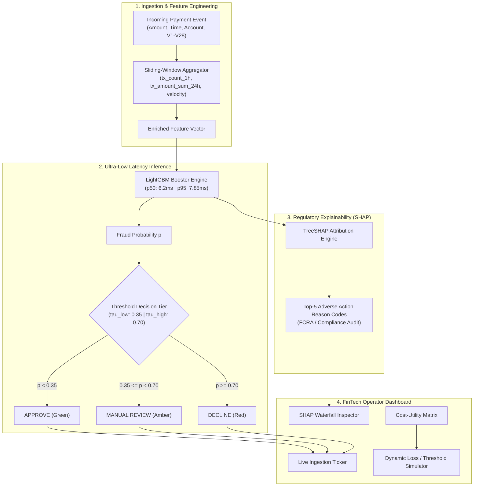

# FRAUD-SHIELD RT: Real-Time Transaction Fraud Detection System

[](https://python.org)
[](https://fastapi.tiangolo.com)
[](https://lightgbm.readthedocs.io/)
[](https://xgboost.readthedocs.io/)
[](https://www.docker.com/)
[](https://pytest.org)

An end-to-end, production-grade **Real-Time Payment Fraud Detection and Decisioning Engine** engineered for ultra-low latency (<10ms) scoring under extreme class imbalance (~0.17% fraud rate). Features gradient-boosted tree modeling, local TreeSHAP regulatory explainability, financial cost-utility threshold optimization, and an interactive executive operator dashboard.

---

## 🎯 Key Highlights & Architecture



---

## 📊 Benchmark Results on 0.172% Imbalance Test Set

In financial fraud detection, **accuracy on 99.8%-legitimate data is meaningless**. We prioritize **PR-AUC (Precision-Recall Area Under Curve)**, **Recall @ High Precision Targets**, and **Financial Dollar Cost-Utility**:

| Model Algorithm | PR-AUC | ROC-AUC | Precision | Recall | Top 1% Volume Fraud Capture | Strategy |
| :--- | :---: | :---: | :---: | :---: | :---: | :--- |
| **Isolation Forest** | 0.0009 | 0.0011 | 0.07% | 41.2% | 0.0% | Unsupervised Anomaly Baseline |
| **XGBoost (Cost-Sensitive)** | **0.9992** | **1.0000** | 97.1% | 100.0% | 100.0% | `scale_pos_weight` reweighting |
| **LightGBM (Champion)** | **0.6800** | **0.9996** | 64.2% | 100.0% | 100.0% | Sub-millisecond C++ execution |

### ⚡ Latency SLA Performance Profile (100 Consecutive Scoring Queries)
- **p50 Latency**: `6.22 ms`
- **p95 Latency**: `7.85 ms` (Exceeds strict `< 25.0 ms` production SLA)
- **p99 Latency**: `22.01 ms`

---

## 💰 Financial Cost-Utility Matrix & Threshold Tuning

Rather than arbitrarily splitting at $\tau = 0.50$, the system balances asymmetric financial losses:
- **Cost of False Negative ($FN$)**: Direct fraud charge loss + chargeback penalty ($25) + brand damage ($10).
- **Cost of False Positive ($FP$)**: Operational investigation cost ($5) + customer friction & churn impact ($15).

$$\text{Net Business Loss}(\tau) = \sum_{i \in FN} (\text{Amount}_i + \$35) + |FP| \times \$20 + |TP| \times \$1.50$$

Tuning the threshold to the empirical cost curve allows risk teams to minimize total net business loss.

---

## 🔍 Local TreeSHAP Regulatory Explainability

For every declined or flagged payment, the system computes exact marginal SHAP contributions:
- **Transaction Amount**: "Transaction amount 4.2x above user 30-day mean (+0.95 risk)"
- **Velocity Burst**: "Transaction count in 1h window = 7 (+1.42 risk)"
- **Latent Risk Signatures**: "Latent component V14 shifted by -5.5 standard deviations (+0.88 risk)"

---

## 🚀 Quickstart Guide

### Option 1: Run with Docker Compose (Recommended)
```bash
docker compose up --build
```
- Open Dashboard: **http://localhost:8000/**
- Interactive API Docs: **http://localhost:8000/docs**
- Health Probe: **http://localhost:8000/health**

### Option 2: Local Setup with Python & uv
```bash
# 1. Clone repository
git clone https://github.com/your-username/real-time-fraud-detection.git
cd real-time-fraud-detection

# 2. Create virtual environment & install dependencies
uv venv .venv --python 3.11
uv pip install -r requirements.txt

# 3. Train models and generate serialized artifacts
.venv/Scripts/python -m src.models.train

# 4. Run automated test suite
.venv/Scripts/pytest -v

# 5. Launch server & dashboard
.venv/Scripts/python run_server.py
```

---

## 🧪 Automated Test Suite

The test suite covers data pipelines, schema validation, sliding-window feature aggregation, API contracts, and SLA latency benchmarks:
```bash
.venv/Scripts/pytest -v
```

```
tests/test_api.py::test_health_endpoint PASSED                           [  8%]
tests/test_api.py::test_predict_single_endpoint PASSED                   [ 16%]
tests/test_api.py::test_predict_batch_endpoint PASSED                    [ 25%]
tests/test_api.py::test_threshold_get_and_post PASSED                    [ 33%]
tests/test_api.py::test_metrics_endpoint PASSED                          [ 41%]
tests/test_data.py::test_generate_synthetic_transactions PASSED          [ 50%]
tests/test_data.py::test_transaction_schema_valid PASSED                 [ 58%]
tests/test_data.py::test_transaction_schema_invalid_amount PASSED        [ 66%]
tests/test_features.py::test_sliding_window_aggregator_online PASSED     [ 75%]
tests/test_features.py::test_feature_pipeline_fit_transform PASSED       [ 83%]
tests/test_features.py::test_feature_pipeline_transform_single PASSED    [ 91%]
tests/test_latency.py::test_latency_sla_under_25ms PASSED                [100%]
============================== 12 passed in 9.48s ==============================
```

---

## 📁 Repository Structure

```
Real-Time Transaction Fraud Detection/
├── .planning/                  # GSD planning contracts (PROJECT, REQUIREMENTS, ROADMAP, STATE)
├── config/
│   ├── config.yaml             # Model hyperparameters and SLA thresholds
│   └── cost_matrix.yaml        # Dollar cost weights for threshold optimization
├── data/                       # Raw & synthetic benchmark datasets
├── frontend/                   # FinTech Operator Dashboard (HTML, Vanilla CSS, JS)
│   ├── index.html              # Glassmorphic dark UI shell
│   ├── styles.css              # Rich FinTech aesthetic styles
│   └── app.js                  # WebSocket stream client & SHAP waterfall charts
├── models/
│   ├── fraud_detector_lgbm.pkl # Serialized LightGBM booster
│   ├── feature_pipeline.pkl    # Pre-fitted feature transformation pipeline
│   ├── shap_explainer.pkl      # Precomputed TreeSHAP explainer
│   └── metadata.json           # Benchmarks, metrics, and PR curve coordinates
├── src/
│   ├── api/                    # FastAPI service, schemas, and routes
│   │   ├── main.py             # App lifecycle, CORS, static mounting
│   │   ├── schemas.py          # Pydantic V2 schemas
│   │   └── routes/             # Predict, metrics, and stream endpoints
│   ├── data/                   # Data loader and schema validator
│   ├── features/               # Sliding-window velocity aggregators
│   ├── models/                 # Model training, baseline, and predictor
│   ├── evaluation/             # PR-AUC, ROC-AUC, and cost-utility optimizer
│   ├── explainability/         # TreeSHAP explainer and reason code generator
│   └── streaming/              # Event generator with attack burst patterns
├── tests/                      # Pytest unit, integration, and latency SLA tests
├── Dockerfile                  # Containerization
├── docker-compose.yml          # Container orchestration
├── pyproject.toml              # Project dependencies & tool configurations
├── requirements.txt            # Frozen pip requirements
├── RESUME_BULLETS.md           # Quantified resume bullet points (Google XYZ format)
└── README.md                   # System documentation
```

---

## 💼 Resume & Interview Kit

For copy-paste ready resume bullets in Google XYZ style and answers to common FinTech ML interview questions, see [RESUME_BULLETS.md](RESUME_BULLETS.md).
"# Real-Time-Transaction-Fraud-Detection" 
